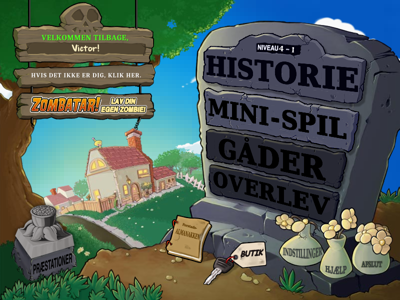

# PlanterModZombier

PlanterModZombier is an unofficial community project to translate the original *Plants vs. Zombies* into Danish. The project currently has one maintainer. Suggestions, corrections, and reports of missing translations are welcome through [GitHub Issues](https://github.com/attacksnack/PlanterModZombier/issues).

## Screenshots




## Install the Danish translation

1. Close *Plants vs. Zombies*.
2. Open the game's installation folder and find `main.pak`. On Steam, right-click the game in your Library and select **Manage → Browse local files**.
3. Copy the original `main.pak` to a separate folder so you can restore it later.
4. Download `main.pak` from the [the repository’s main branch](https://github.com/attacksnack/PlanterModZombier/raw/refs/heads/main/main.pak).
5. Copy the downloaded `main.pak` into the game's installation folder and confirm that you want to replace the existing file. Make sure the replacement is named exactly `main.pak`.
6. Start the game.

### Restore the original game

Close the game and copy your backed-up `main.pak` into the installation folder, replacing the Danish package.

## Project files

- `main.pak` is the current installable Danish package.
- `assets/images/` and `assets/reanim/` contain the localized artwork.
- `assets/properties/LawnStrings.txt` contains the game-ready Danish strings. The same folder contains the original strings, translation chunks, and the script used to merge those chunks.
- `tools/pak_tool.py` lists, unpacks, and repacks the uncompressed PopCap PAK format used by the PC game.

## Build a package with the PAK tool

Use Python 3.7 or later. The tool uses only Python’s standard library. Run these commands from the repository root. On Windows, use `py -3` if `python` is unavailable.

1. Copy the game’s `main.pak` into the repository root and unpack it into a fresh folder. The repository already includes a Danish `main.pak`, so copying in a different package replaces that local copy.

   ```sh
   python tools/pak_tool.py unpack main.pak extracted
   ```

2. Edit `extracted/properties/LawnStrings.txt` or replace it with the copy from `assets/properties/`. To apply the localized artwork, copy the files from `assets/images/` and `assets/reanim/` over their counterparts in `extracted/`. Preserve the extracted filenames and paths, including capitalization. Keep the extracted `_manifest.json` so the tool can reuse the original archive order and timestamps.

3. Repack the entire extracted directory to `main_new.pak` to preserve the input `main.pak`. Keep the output outside `extracted/` because the tool packs every file inside that folder except its manifest. Use `--force` when you want to overwrite an earlier build.

   ```sh
   python tools/pak_tool.py repack extracted main_new.pak --force
   ```

   By default, the tool converts supported UTF-8 sequences in `LawnStrings.txt` to Windows-1252 as it packs. It leaves the source file on disk untouched. Replace any characters the tool warns about before installing the package. Use `--no-text-fix` when you want the tool to preserve the text file byte for byte.

4. List the archive contents to check that the package can be read. To test in the game, follow the installation steps above using a copy of `main_new.pak` renamed to `main.pak`.

   ```sh
   python tools/pak_tool.py list main_new.pak
   ```
